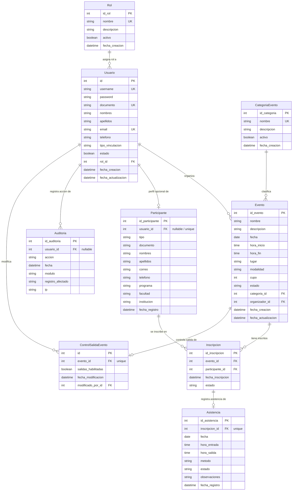

# 05. MODELO DE DATOS, ENTIDADES Y ESTRUCTURA RELACIONAL

**Sistema:** EventosSIGAE-UNIMINUTO  
**Motor Base:** SQLite (Desarrollo y pruebas locales) / PostgreSQL 16 (Configurada y compatible)  
**Propósito:** Describir la arquitectura de persistencia relacional, especificación de modelos, tipos de datos, restricciones de integridad, relaciones y el diagrama Entidad-Relación (ER) oficial del sistema.

---

## 1. Configuración del Motor de Base de Datos

El archivo [`config/settings.py`](file:///c:/Users/cristian.fresnosG/Desktop/Python/SIGAE-UNIMINUTO/config/settings.py#L165-L241) implementa una arquitectura de base de datos **híbrida y desacoplada** con soporte de doce factores (*12-Factor App*):

### A. Entorno de Desarrollo y Pruebas Locales (SQLite)
- Por defecto, Django conecta con SQLite 3 mediante `django.db.backends.sqlite3`.
- **Aislamiento Seguro con `SIGAE_DB_PATH`:**  
  Permite definir dinámicamente mediante variable de entorno la ruta exacta de la base de datos a utilizar:
  ```python
  sigae_db_path = os.environ.get('SIGAE_DB_PATH', '').strip()
  DATABASES = {
      'default': {
          'ENGINE': 'django.db.backends.sqlite3',
          'NAME': Path(sigae_db_path) if sigae_db_path else BASE_DIR / 'db.sqlite3',
      }
  }
  ```
  Esto permite que las pruebas y demostraciones operen de forma segura sobre `db.sqlite3.demo` preservando intacta la base original `db.sqlite3`.

### B. Entorno de Producción (PostgreSQL)
- Soporta configuración mediante la variable estándar `DATABASE_URL` (parseada internamente con `urllib.parse` sin librerías externas) o parámetros individuales (`DB_HOST`, `DB_PORT`, `DB_NAME`, `DB_USER`, `DB_PASSWORD`).
- Utiliza el driver oficial `psycopg` (versión 3.3.6) y soporta agrupación de conexiones mediante `CONN_MAX_AGE`.

---

## 2. Diagrama Entidad-Relación (Mermaid ER)

El siguiente diagrama modela fielmente las 8 entidades relacionales del sistema y sus vínculos cardinales:



---

## 3. Especificación Técnica de los Modelos

### 1. `usuarios.Rol`
- **Tabla en BD:** `usuarios_rol`
- **Propósito:** Catálogo institucional de privilegios de usuario.
- **Campos:**
  - `id_rol`: AutoField, Clave Primaria.
  - `nombre`: CharField(50), Único (`Administrador`, `Coordinador`, `Docente`, `Estudiante`).
  - `descripcion`: TextField, Nulo/En blanco permitido.
  - `activo`: BooleanField, por defecto `True`.
  - `fecha_creacion`: DateTimeField, `auto_now_add=True`.

---

### 2. `usuarios.Usuario` (Hereda de `AbstractUser`)
- **Tabla en BD:** `usuarios_usuario`
- **Propósito:** Entidad de autenticación de personas con cuenta en el sistema.
- **Campos Principales:**
  - `id`: AutoField, Clave Primaria.
  - `username`: CharField(150), Único.
  - `password`: CharField(128) (almacena el hash seguro PBKDF2).
  - `documento`: CharField(20), Único.
  - `nombres`: CharField(100).
  - `apellidos`: CharField(100).
  - `email`: EmailField, Único.
  - `telefono`: CharField(20), opcional.
  - `tipo_vinculacion`: CharField(30), opcional (ej. "Docente TC", "Pregrado").
  - `rol`: ForeignKey hacia `usuarios.Rol`, con `on_delete=models.PROTECT`.
  - `estado`: BooleanField, por defecto `True`.
- **Ajustes de Modelo:** Se deshabilitaron los campos heredados `first_name` y `last_name` (`None`) para evitar redundancia con `nombres` y `apellidos`.

---

### 3. `eventos.CategoriaEvento`
- **Tabla en BD:** `eventos_categoriaevento`
- **Propósito:** Clasificación temática de las actividades.
- **Campos:**
  - `id_categoria`: AutoField, Clave Primaria.
  - `nombre`: CharField(100), Único (ej. "Seminario", "Congreso", "Taller").
  - `descripcion`: TextField, opcional.
  - `activo`: BooleanField, por defecto `True`.

---

### 4. `eventos.Evento`
- **Tabla en BD:** `eventos_evento`
- **Propósito:** Entidad central que define la actividad institucional.
- **Campos:**
  - `id_evento`: AutoField, Clave Primaria.
  - `nombre`: CharField(200).
  - `descripcion`: TextField.
  - `fecha`: DateField.
  - `hora_inicio`: TimeField.
  - `hora_fin`: TimeField.
  - `lugar`: CharField(200) (ej. "Auditorio Principal", "Aula Magna", "Enlace Teams").
  - `modalidad`: CharField(30), opciones `PRESENCIAL`, `VIRTUAL`, `HIBRIDA`.
  - `cupo`: PositiveIntegerField, opcional (si es nulo indica aforo ilimitado).
  - `estado`: CharField(30), opciones `BORRADOR`, `PUBLICADO`, `CERRADO`, `CANCELADO`, `FINALIZADO` (default `BORRADOR`).
  - `categoria`: ForeignKey hacia `CategoriaEvento`, `on_delete=models.PROTECT`.
  - `organizador`: ForeignKey hacia `Usuario`, `on_delete=models.PROTECT`.
- **Validación `clean()`:** Exige que `hora_fin > hora_inicio`.

---

### 5. `participantes.Participante`
- **Tabla en BD:** `participantes_participante`
- **Propósito:** Representa a la persona asistente, permitiendo tanto usuarios registrados como público externo.
- **Campos:**
  - `id_participante`: AutoField, Clave Primaria.
  - `usuario`: OneToOneField hacia `Usuario`, opcional (`null=True, blank=True`), `on_delete=models.SET_NULL`.
  - `tipo`: CharField(30), opciones `ESTUDIANTE`, `DOCENTE`, `ADMINISTRATIVO`, `EGRESADO`, `EXTERNO`, `OTRO`.
  - `documento`: CharField(20).
  - `nombres`: CharField(100).
  - `apellidos`: CharField(100).
  - `correo`: EmailField(254).
  - `telefono`: CharField(20), opcional.
  - `programa` / `facultad`: CharField(150), opcionales.
  - `institucion`: CharField(200), opcional (ej. "UNIMINUTO", "Empresa Externa").

---

### 6. `participantes.Inscripcion`
- **Tabla en BD:** `participantes_inscripcion`
- **Propósito:** Tabla de relación N:M entre `Evento` y `Participante`.
- **Campos:**
  - `id_inscripcion`: AutoField, Clave Primaria.
  - `evento`: ForeignKey hacia `Evento`, `on_delete=models.PROTECT`.
  - `participante`: ForeignKey hacia `Participante`, `on_delete=models.PROTECT`.
  - `fecha_inscripcion`: DateTimeField, `auto_now_add=True`.
  - `estado`: CharField(30), opciones `ACTIVA`, `CANCELADA`.
- **Restricción de Integridad:**  
  `UniqueConstraint(fields=['evento', 'participante'], name='unique_evento_participante')`.  
  Evita que un mismo participante tenga dos registros para el mismo evento a nivel de motor de base de datos.
- **Propiedad `@property asistio`:**  
  Retorna `True` únicamente si existe una relación con `Asistencia` y su estado es `REGISTRADA`.

---

### 7. `asistencia.Asistencia`
- **Tabla en BD:** `asistencia_asistencia`
- **Propósito:** Registro formal de presencia, hora de llegada, hora de salida y permanencia.
- **Campos:**
  - `id_asistencia`: AutoField, Clave Primaria.
  - `inscripcion`: OneToOneField hacia `Inscripcion`, `on_delete=models.PROTECT`.  
    *(Una inscripción solo puede tener un registro de asistencia en el sistema).*
  - `fecha`: DateField.
  - `hora_entrada`: TimeField, opcional.
  - `hora_salida`: TimeField, opcional.
  - `metodo`: CharField(30), opciones `QR`, `MANUAL`, `LISTA`, `OTRO` (default `MANUAL`).
  - `estado`: CharField(30), opciones `REGISTRADA`, `ANULADA` (default `REGISTRADA`).
  - `observaciones`: TextField, opcional.
- **Propiedad `@property permanencia`:**  
  Calcula la diferencia temporal `hora_salida - hora_entrada` y maneja transiciones que cruzan la medianoche (madrugada siguiente).
- **Validación `clean()`:**
  - No admite `hora_salida` sin `hora_entrada`.
  - No admite `hora_salida == hora_entrada`.
  - Si `hora_salida < hora_entrada`, exige que sea un cruce de medianoche verosímil ($\ge 18:00$ y $\le 08:00$).
  - Impide registrar asistencia en eventos con estado `CANCELADO`.

---

### 8. `asistencia.ControlSalidaEvento`
- **Tabla en BD:** `asistencia_controlsalidaevento`
- **Propósito:** Estado de activación del registro de salidas para cada evento.
- **Campos:**
  - `id`: AutoField, Clave Primaria.
  - `evento`: OneToOneField hacia `Evento`, `on_delete=models.CASCADE`.
  - `salidas_habilitadas`: BooleanField, por defecto `False`.
  - `fecha_modificacion`: DateTimeField, `auto_now=True`.
  - `modificado_por`: ForeignKey hacia `Usuario`, opcional, `on_delete=models.SET_NULL`.

---

### 9. `auditoria.Auditoria`
- **Tabla en BD:** `auditoria_auditoria`
- **Propósito:** Bitácora inmutable de eventos de seguridad y cambios operacionales.
- **Campos:**
  - `id_auditoria`: AutoField, Clave Primaria.
  - `usuario`: ForeignKey hacia `Usuario`, opcional (`SET_NULL`), permite registrar acciones anónimas.
  - `accion`: CharField(100) (ej. `INICIAR_SESION`, `REGISTRAR_ASISTENCIA`, `CANCELAR_EVENTO`).
  - `modulo`: CharField(100) (`USUARIOS`, `EVENTOS`, `PARTICIPANTES`, `ASISTENCIA`, `REPORTES`, `ANALITICA`, `AUDITORIA`).
  - `registro_afectado`: CharField(100), descripción sintética del registro modificado.
  - `ip`: GenericIPAddressField, dirección IPv4 o IPv6 capturada del cliente.
  - `fecha`: DateTimeField, `auto_now_add=True`.

---

## 4. Historial de Migraciones del Proyecto

Las migraciones de Django representan el control de versiones del esquema de base de datos:

| Aplicación | Migración | Descripción del Cambio en el Esquema |
| :--- | :--- | :--- |
| **`usuarios`** | `0001_initial` | Creación de tablas `Rol` y `Usuario` (AbstractUser personalizado). |
| **`eventos`** | `0001_initial` | Creación de tablas `CategoriaEvento` y `Evento`. |
| **`participantes`** | `0001_initial` | Creación de tablas `Participante` e `Inscripcion`. |
| | `0002_alter_participante_usuario` | Ajuste a relación `OneToOneField` opcional hacia `Usuario`. |
| | `0003_alter_inscripcion_estado` | Estandarización de estados `ACTIVA` y `CANCELADA`. |
| **`asistencia`** | `0001_initial` | Creación inicial de `Asistencia`. |
| | `0002_alter_asistencia_inscripcion` | Normalización de relación `OneToOneField` con `Inscripcion`. |
| | `0003_controlsalidaevento` | Creación de tabla para interruptor de habilitación de salidas por evento. |
| **`reportes`** | `0001_initial` | Creación inicial de histórico de planillas. |
| | `0002_delete_planilla` | Eliminación de persistencia estática en BD; adopción de arquitectura stateless en memoria. |
| **`auditoria`** | `0001_initial` | Creación de tabla `Auditoria` y sus índices. |
| **`analitica`** | *(Sin migraciones)* | Operaciones analíticas computadas en tiempo real sin tablas propias. |

---

## 5. Dónde se Consulta y Modifica Cada Entidad

| Entidad / Modelo | Archivo de Consulta Principal | Archivo de Modificación / Escritura |
| :--- | :--- | :--- |
| `Usuario` / `Rol` | [`usuarios/views.py`](file:///c:/Users/cristian.fresnosG/Desktop/Python/SIGAE-UNIMINUTO/usuarios/views.py) (`login_view`), `admin.py` | `usuarios/views.py`, `inicializar_roles.py` |
| `Evento` | [`eventos/views.py`](file:///c:/Users/cristian.fresnosG/Desktop/Python/SIGAE-UNIMINUTO/eventos/views.py) (`catalogo_eventos`, `detalle_evento`) | `eventos/views.py` (`crear_evento`, `cancelar_evento`) |
| `Participante` | [`participantes/views.py`](file:///c:/Users/cristian.fresnosG/Desktop/Python/SIGAE-UNIMINUTO/participantes/views.py) (`inscribirse_evento`) | `participantes/views.py` (`inscribirse_evento`) |
| `Inscripcion` | [`participantes/views.py`](file:///c:/Users/cristian.fresnosG/Desktop/Python/SIGAE-UNIMINUTO/participantes/views.py) (`mis_inscripciones`), `asistencia/views.py` | `participantes/views.py` (`cancelar_inscripcion`), `inscribirse_evento` |
| `Asistencia` | [`asistencia/views.py`](file:///c:/Users/cristian.fresnosG/Desktop/Python/SIGAE-UNIMINUTO/asistencia/views.py) (`control_asistencia`), `reportes/services.py` | [`asistencia/services.py`](file:///c:/Users/cristian.fresnosG/Desktop/Python/SIGAE-UNIMINUTO/asistencia/services.py) (`registrar_asistencia_llegada`, `registrar_asistencia_salida`) |
| `ControlSalidaEvento` | [`asistencia/services.py`](file:///c:/Users/cristian.fresnosG/Desktop/Python/SIGAE-UNIMINUTO/asistencia/services.py) (`es_salida_habilitada`) | [`asistencia/services.py`](file:///c:/Users/cristian.fresnosG/Desktop/Python/SIGAE-UNIMINUTO/asistencia/services.py) (`toggle_salidas_evento_service`) |
| `Auditoria` | [`auditoria/views.py`](file:///c:/Users/cristian.fresnosG/Desktop/Python/SIGAE-UNIMINUTO/auditoria/views.py) (`consulta_auditoria`) | Registrada automáticamente en vistas de todos los módulos |
